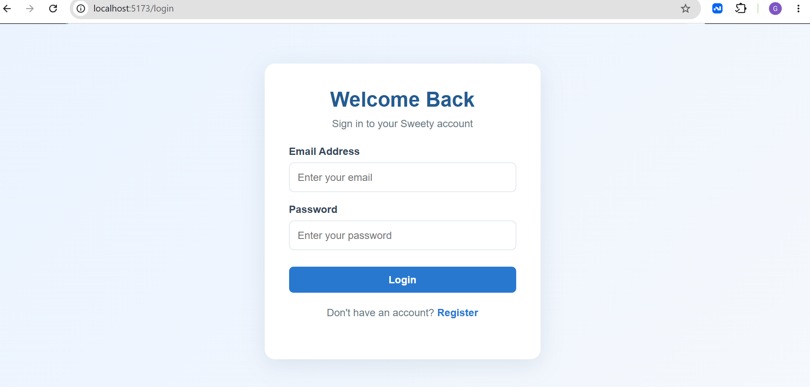
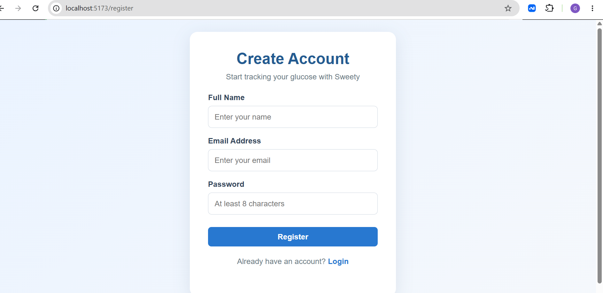
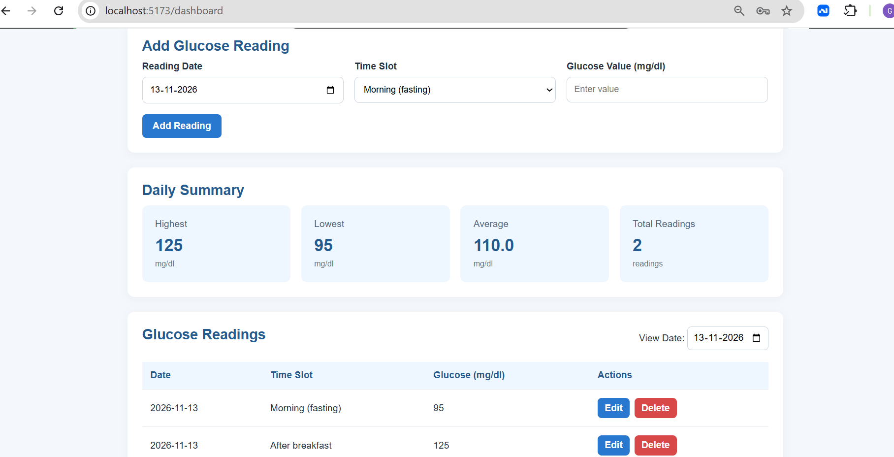
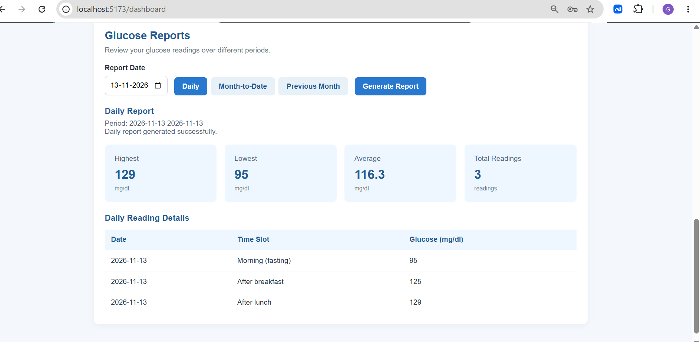
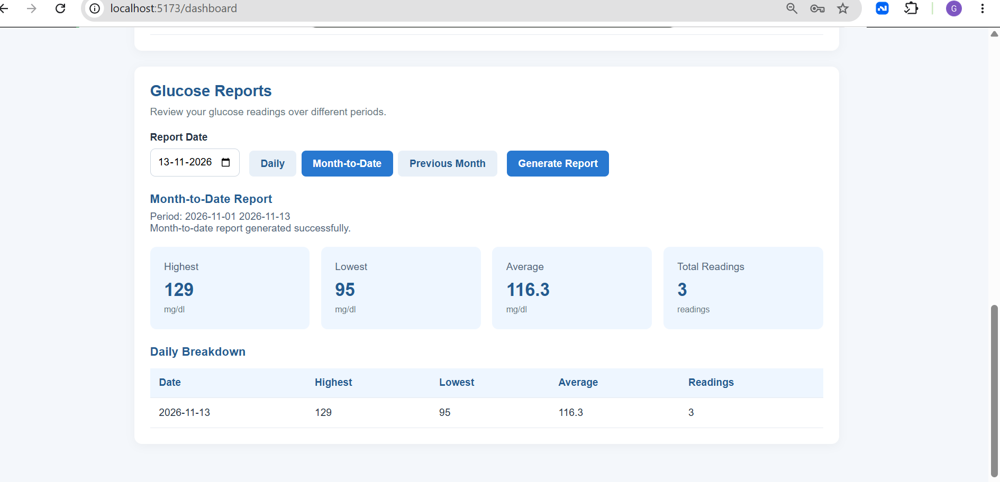

# Sweety – Blood Glucose Tracker

A full-stack web application that allows users to securely record, manage, and monitor their blood glucose readings. Sweety provides daily and monthly reports to help users understand their glucose reading history through a simple and user-friendly dashboard.

## Features

### 1. User Authentication
- User registration with name, email, and password.
- Secure password hashing using bcrypt.
- User login with JWT authentication.
- Protected API routes.
- Users can access only their own glucose readings.

### 2. Blood Glucose Reading Management
- Add new blood glucose readings.
- View previously recorded readings.
- Update existing readings.
- Delete readings.
- Select a date and time slot for each reading.

The application supports four daily reading slots:

- Morning (fasting)
- After breakfast
- After lunch
- After dinner

### 3. Reading Validation

The application implements the following validation rules:

| Validation | Error Message |
|---|---|
| Empty glucose value | Please enter a glucose value. |
| Value outside 40–600 mg/dl | Value must be between 40 and 600 mg/dl. |
| Duplicate time slot | You already have a reading for this date and time slot. |
| More than four readings per day | You can add only 4 readings per day. |
| Future reading date | Date cannot be in the future. |

Additional database constraints prevent duplicate readings for the same user, date, and time slot.

### 4. Reports and Statistics

The application provides three reporting periods:

**Daily Report**
- View readings for a selected date.
- Display individual reading values and time slots.
- Calculate highest, lowest, and average glucose values.
- Display the total number of readings.

**Month-to-Date Report**
- Displays readings from the first day of the selected month through the selected date.
- Provides highest, lowest, average, and total reading statistics.

**Monthly Report**
- Displays statistics for the complete previous calendar month.
- Provides highest, lowest, average, and total reading statistics.

Average glucose values are rounded to one decimal place.

### 5. Dashboard
- User-friendly dashboard.
- Blood glucose reading entry form.
- Reading history.
- Edit and delete actions.
- Summary statistics.
- Reports section.
  

---

## Application Screenshots

### 1. Login Page

### 2. Registration Page

### 3. Dashboard

### 4. Daily Report

### 5. Monthly Reports

---

---

## Technology Stack

### Frontend
- React.js
- JavaScript
- HTML5
- CSS3
- Vite
- Axios
- React Router

### Backend
- Node.js
- Express.js
- REST API
- JSON Web Tokens (JWT)
- bcrypt

### Database
- PostgreSQL

### Development Tools
- Visual Studio Code
- Git
- GitHub
- Postman
- PowerShell

---

## Project Structure

sweety-blood-glucose-tracker/
│
├── client/
│   ├── public/
│   ├── src/
│   │   ├── pages/
│   │   ├── services/
│   │   ├── App.jsx
│   │   ├── main.jsx
│   │   └── index.css
│   ├── .env.example
│   ├── package.json
│   └── vite.config.js
│
├── server/
│   ├── config/
│   │   └── db.js
│   ├── controllers/
│   │   ├── authController.js
│   │   ├── readingController.js
│   │   └── reportController.js
│   ├── middleware/
│   │   └── authMiddleware.js
│   ├── routes/
│   │   ├── authRoutes.js
│   │   ├── readingRoutes.js
│   │   └── reportRoutes.js
│   ├── scripts/
│   │   └── seed.js
│   ├── tests/
│   ├── .env.example
│   ├── app.js
│   ├── server.js
│   └── package.json
│
├── database/
│   └── schema.sql
│
├── .gitignore
└── README.md

---

## Getting Started

Follow these instructions to run the project locally.

### Prerequisites

Install the following software:

- Node.js
- npm
- PostgreSQL
- Git

### 1. Clone the Repository

git clone https://github.com/Gopaldr/sweety-blood-glucose-tracker.git

Navigate to the project directory:

cd sweety-blood-glucose-tracker

### 2. Set Up PostgreSQL Database

Start your PostgreSQL service.

Open PostgreSQL or PowerShell and create the database:

CREATE DATABASE sweety_db;

Navigate to the project root directory and execute the schema file:

psql -U postgres -d sweety_db -f database/schema.sql

The schema creates the following tables:

**users**
- id
- name
- email
- password_hash
- created_at

**readings**
- id
- user_id
- reading_date
- time_slot
- glucose_value
- created_at
- updated_at

The database also includes:
- Primary key constraints.
- Foreign key relationship between users and readings.
- Unique email constraint.
- Glucose value constraint (40–600).
- Valid time-slot constraint.
- Unique user/date/time-slot constraint.
- Index for user and reading date queries.

### 3. Configure Backend Environment

Navigate to the server directory:

cd server

Create your local environment file:

Copy-Item .env.example .env

Open the file:

notepad .env

Configure your PostgreSQL credentials and a strong JWT secret:

PORT=5000

DB_USER=postgres
DB_HOST=localhost
DB_NAME=sweety_db
DB_PASSWORD=your_postgresql_password
DB_PORT=5432

JWT_SECRET=your_long_random_secret

CLIENT_URL=http://localhost:5173

Replace the example database password and JWT secret with your own local values.

### 4. Install Backend Dependencies

From the server directory:

npm install

### 5. Start the Backend Server

npm run dev

Expected output:

PostgreSQL connected successfully!
Sweety API running on port 5000

Backend health-check endpoint:

http://localhost:5000/api/health

### 6. Configure Frontend Environment

Open another PowerShell window.

Navigate to the client directory:

cd C:\Users\gopal\Documents\sweety-blood-glucose-tracker\client

Create the frontend environment file:

Copy-Item .env.example .env

The frontend environment file should contain:

VITE_API_URL=http://localhost:5000/api

### 7. Install Frontend Dependencies

npm install

### 8. Start the Frontend

npm run dev

Vite displays the local frontend URL. Open the URL shown in your terminal.

Usually:

http://localhost:5173

If port 5173 is already in use, Vite may select another port, such as 5174.

Keep both backend and frontend terminals running.

---

## API Endpoints

All API endpoints are prefixed with:

http://localhost:5000/api

### Authentication APIs

| Method | Endpoint | Description | Authentication |
|---|---|---|---|
| POST | /auth/register | Register a new user | No |
| POST | /auth/login | Authenticate user | No |
| GET | /auth/me | Get authenticated user details | Yes |

### Blood Glucose Reading APIs

| Method | Endpoint | Description |
|---|---|---|
| GET | /readings | Retrieve readings |
| POST | /readings | Add a reading |
| PUT | /readings/:id | Update a reading |
| DELETE | /readings/:id | Delete a reading |

All reading endpoints require JWT authentication.

### Reporting APIs

| Method | Endpoint | Description |
|---|---|---|
| GET | /reports/daily | Daily glucose report |
| GET | /reports/month-to-date | Month-to-date report |
| GET | /reports/monthly | Previous calendar month report |

All reporting endpoints require JWT authentication.

---

## Security Implementation

The application includes the following security measures:

- Password hashing using bcrypt.
- JWT-based authentication.
- Protected backend routes.
- User-specific reading access.
- Database constraints to maintain data integrity.
- Parameterized SQL queries.
- Environment variables for sensitive configuration.
- Password hashes are stored instead of plain-text passwords.

---

## Testing

The application can be tested through the following workflows:

1. Register a new user.
2. Log in with registered credentials.
3. Add a blood glucose reading.
4. Verify that the reading appears in the dashboard.
5. Update an existing reading.
6. Delete a reading.
7. Try entering an invalid glucose value.
8. Try adding a duplicate time slot for the same date.
9. Try adding more than four readings in one day.
10. Check daily, month-to-date, and monthly reports.
11. Verify that one user cannot access another user's readings.

---

## Database Seeding

The backend includes a seed script to populate the database with demonstration data.

From the server directory, run:

npm run seed

The script creates a demo user and sample glucose readings.

Use the demo credentials printed by the seed script for local demonstration only. Change the demo password before using the application in any publicly accessible environment.

---

## Future Improvements

The following features can be considered for future development:

- Interactive glucose trend charts.
- Export reports as PDF or CSV.
- Medication and meal tracking.
- Custom date-range reports.
- Email notifications and reminders.
- Deployment to a cloud hosting platform.
- Automated backend and frontend testing.
- Improved accessibility and user experience.

---

## Author

**Gopal Reddy Desireddy**

GitHub: [Gopaldr](https://github.com/Gopaldr)

Project Repository: [Sweety – Blood Glucose Tracker](https://github.com/Gopaldr/sweety-blood-glucose-tracker)

---

## License

This project is developed for learning and demonstration purposes. A formal open-source license can be added separately if the project is intended for public reuse.